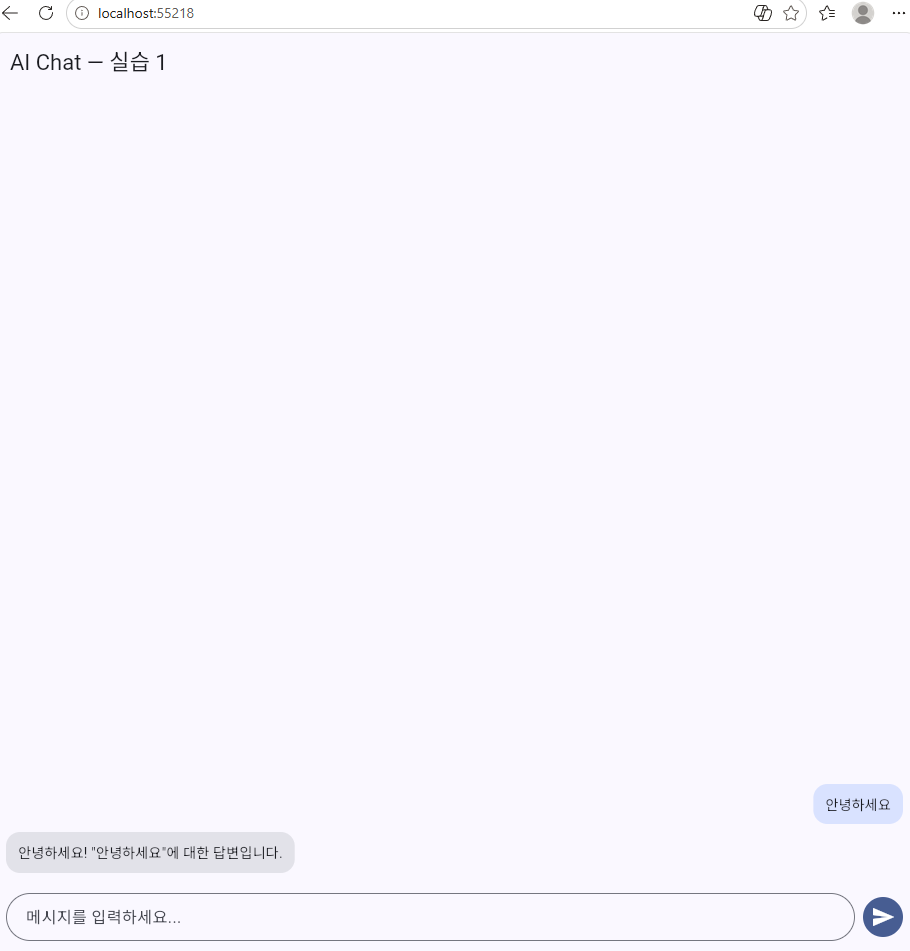
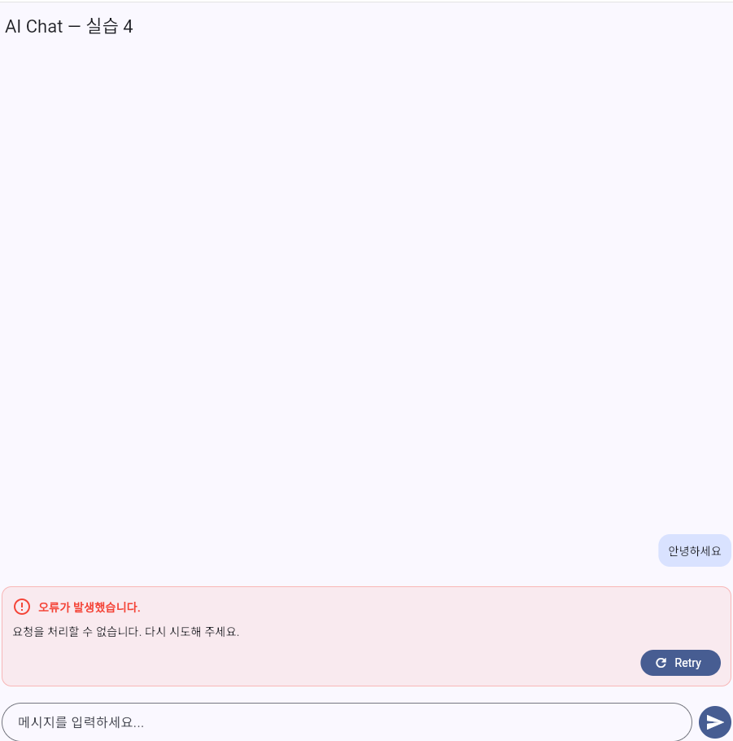
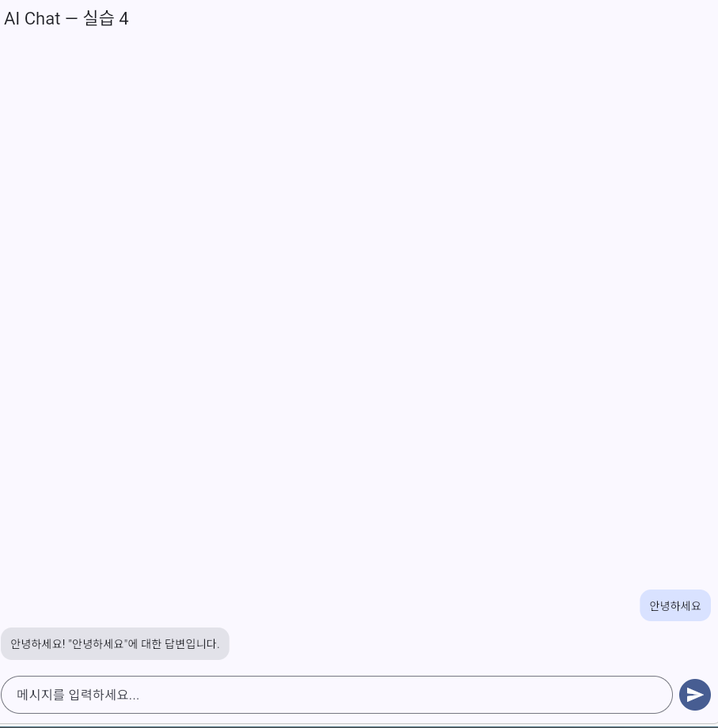

# 실습 1 — 채팅 UI + 실습 4 — 오류와 재시도
**GAI3008-01 · 11주차**

## 1. 프로젝트 소개

Flutter를 사용하여 간단한 AI 채팅 UI를 구현한 프로젝트입니다.

실습 1에서는 채팅 메시지 UI와 입력 기능을 구현하고, 실습 4에서는 오류 발생 시 오류 메시지를 표시하고 Retry 버튼을 통해 다시 요청할 수 있도록 구현했습니다.

## 2. 실행 방법

```bash
flutter pub get
flutter run -d chrome
```

## 3. 구현 내용

### 실습 1 — 채팅 UI

| # | 내용 | 상태 |
|---|---|---|
| 1 | ListView.builder + reverse: true | 완료 |
| 2 | 말풍선 2종 — 사용자 오른쪽 / AI 왼쪽 | 완료 |
| 3 | 입력창 + 전송 버튼 TextField | 완료 |
| 4 | 빈 상태 — "무엇이든 물어보세요" | 완료 |
| 5 | 키보드 입력 및 화면 대응 | 구현 및 테스트 |

### 실습 4 — 오류와 재시도

| # | 내용 | 상태 |
|---|---|---|
| 1 | 요청 중 Loading 상태 표시 | 완료 |
| 2 | 오류 발생 시 오류 메시지 표시 | 완료 |
| 3 | Retry 버튼 표시 | 완료 |
| 4 | Retry 클릭 시 재요청 | 완료 |
| 5 | 재요청 성공 후 AI 답변 표시 | 완료 |

## 4. 실행 화면

### 4-1. 채팅 UI

사용자 메시지는 오른쪽, AI 메시지는 왼쪽에 표시됩니다.



### 4-2. 오류 발생 화면

요청 실패 시 오류 메시지와 Retry 버튼을 표시합니다.



### 4-3. Retry 성공 화면

Retry 버튼을 클릭하면 다시 요청하고 AI 답변을 표시합니다.



## 5. 테스트 결과

- 채팅 메시지 전송 확인
- 사용자 및 AI 말풍선 위치 확인
- 빈 메시지 전송 방지 확인
- 오류 메시지 표시 확인
- Retry 버튼 동작 확인
- 재시도 후 AI 답변 표시 확인

## 6. 참고 사항

본 프로젝트의 AI 응답과 오류 상황은 UI 및 재시도 기능 테스트를 위한 시뮬레이션입니다. 실제 AI 서버 API와 연결되어 있지 않습니다.